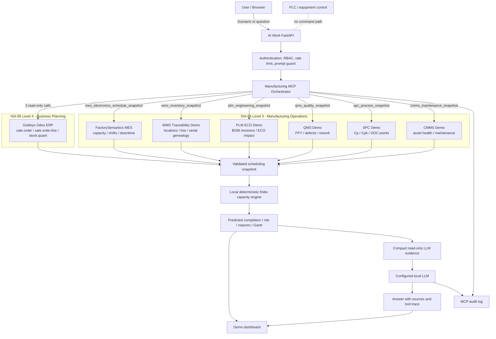

# Electronics Manufacturing Scheduling Demo Architecture

## Scope

The demo is a read-only decision-support workflow. It combines business,
manufacturing, warehouse, engineering, quality, process-control, and
maintenance evidence through bounded MCP tools. A deterministic local engine
calculates the schedule. The LLM explains the calculated result; it does not
operate enterprise systems or PLCs.

## Systems

| System | Demo responsibility | Scheduling effect |
| --- | --- | --- |
| Odoo ERP | Sales orders, order lines, customers, due dates, and stock quants | Demand, priority, requested delivery, and ERP stock evidence |
| FactorySemantics MES | Work centers, shifts, rates, downtime, and teaching work orders | Finite capacity and unavailable production time |
| WMS Traceability | Locations, lots, material readiness, serial genealogy, and recall impact | Material-ready time and traceability evidence |
| PLM / ECO | Released BOM revisions, product revisions, ECO differences, and change impact | Additional setup and engineering-operation time |
| QMS | Family FPY, defect rates, expected rework, and open quality events | Expected TEST rework time and delivery-risk evidence |
| SPC | Cp/Cpk, control status, out-of-control points, and order quality risk | Additional inspection time and risk score |
| CMMS | Asset health, maintenance work orders, MTBF/MTTR, and maintenance windows | Unavailable capacity and equipment-risk evidence |
| Local scheduler | Work calendar, routing, setup, downtime, and deterministic risk rules | Predicted completion, lateness, reasons, and Gantt operations |
| Local LLM | Explains the supplied schedule evidence in the user's language | Read-only answer with source cards and audited tool trace |

## Detailed Architecture

## Scheduling Flow

1. Authenticate the user and validate the what-if scenario or question.
2. Read up to five schedulable Odoo orders and their order lines.
3. Read related Odoo stock quants, MES capacity, and six support-system
   snapshots through separate loopback-only MCP endpoints.
4. Validate identifiers, numeric limits, timestamps, required product families,
   and work-center relationships. A missing connector produces an explicit
   error; the API never silently substitutes fixtures.
5. Derive material readiness from ERP stock plus WMS family readiness.
6. Add QMS expected rework, PLM engineering/setup time, SPC inspection time,
   MES downtime, and CMMS maintenance windows.
7. Run the local finite-capacity scheduler using workdays, shifts, routing,
   setup state, material readiness, and unavailable windows.
8. Return predicted completion, lateness, a deterministic demo risk score,
   reason strings, source cards, and the complete audited tool trace.
9. For a question, send only compact schedule evidence to the configured local
   LLM. The model explains the result but cannot invoke write tools or control
   production equipment.

## Security Boundary

- Manufacturing support MCPs bind only to `127.0.0.1:8320-8324`.
- Every catalog has an endpoint-specific, fixed read-only tool allowlist.
- Tool arguments use bounded identifiers and numeric ranges.
- All calls are recorded in the MCP audit log.
- No release, recall, ECO apply, maintenance close, alarm acknowledge, order
  update, inventory movement, or PLC-control tool is exposed.
- MES, WMS, PLM, QMS, SPC, and CMMS records in this demo are authored teaching
  data and must not be used for production decisions.
